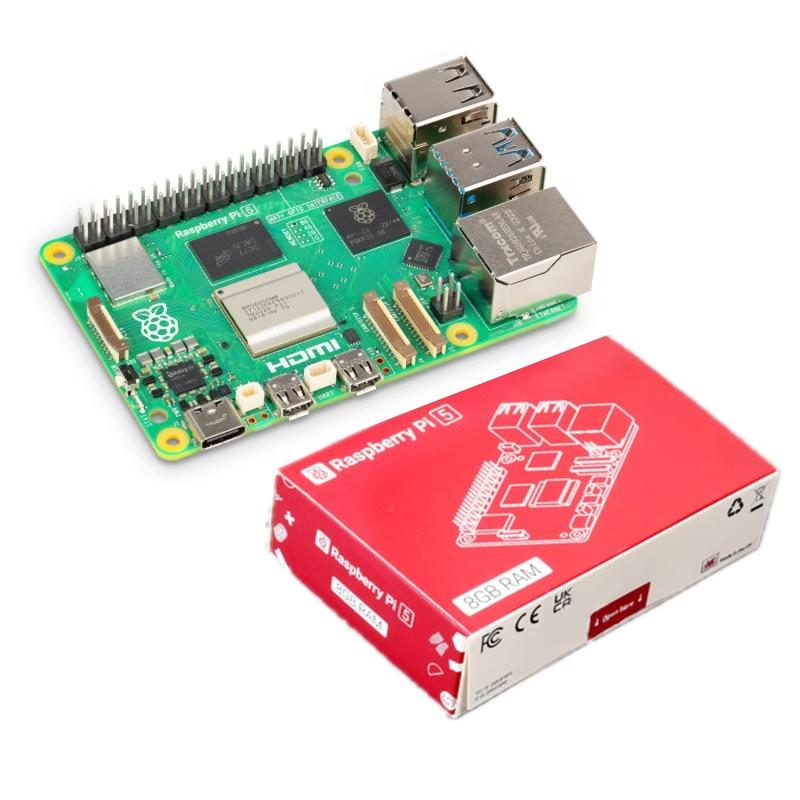
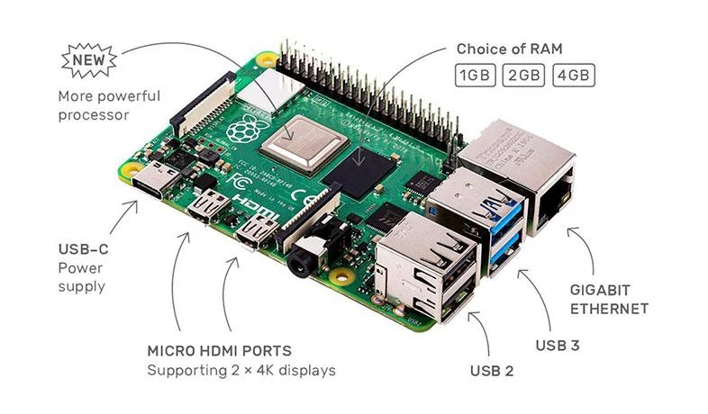

# Part 4 – Raspberry Pi Hardware Identification

---

| Component | Function |
|-----------|----------|
| SoC | System-on-Chip: integrates CPU, GPU, and other logic on one die; runs the operating system and applications. |
| GPIO | General Purpose Input/Output pins for connecting sensors, LEDs, and hats; programmable digital interfaces. |
| USB | Connects peripherals such as keyboard, mouse, storage, and Ethernet adapters (depending on model). |
| HDMI | Digital video (and audio) output to a monitor or TV. |
| Power | USB-C (Pi 4/5) or micro-USB (older models) input; regulated power for the board and attached devices. |
| microSD | Primary boot and storage medium for the Raspberry Pi OS image and user files. |
| Network | Ethernet port for wired LAN connectivity (model-dependent). |
| Wireless | On-board Wi-Fi and Bluetooth for wireless networking and peripherals (on supported models). |

---
## Reflection
Why are many components integrated into a single board in embedded computers such as the Raspberry Pi?
Write **100 words**.

Embedded boards like the Raspberry Pi prioritise size, cost, and power efficiency over desktop-style upgradability. Integrating the CPU, GPU, memory controller, and I/O into a single SoC reduces chip count, shortens signal paths, and lowers manufacturing complexity. Fewer sockets and cables mean a smaller PCB that fits in portable or industrial enclosures. Fixed RAM and unified design simplify software support because every unit shares a known hardware profile. Trade-offs include limited upgrade paths and tighter thermal constraints, but for education, prototyping, and appliances, a single compact board delivers sufficient performance while remaining affordable and easy to deploy in classrooms and maker projects.
